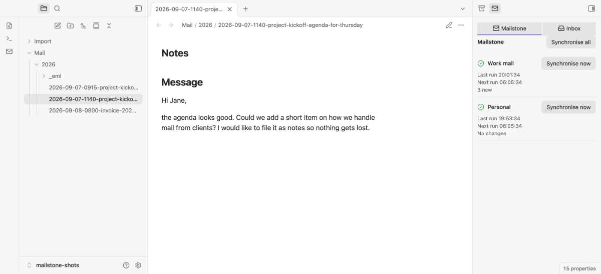
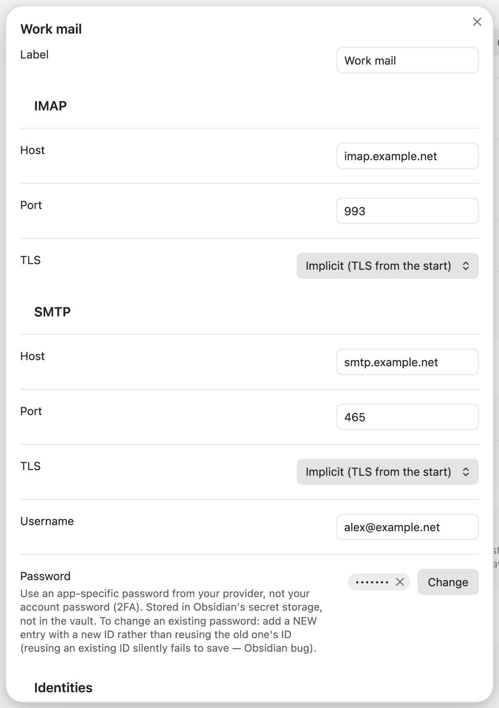
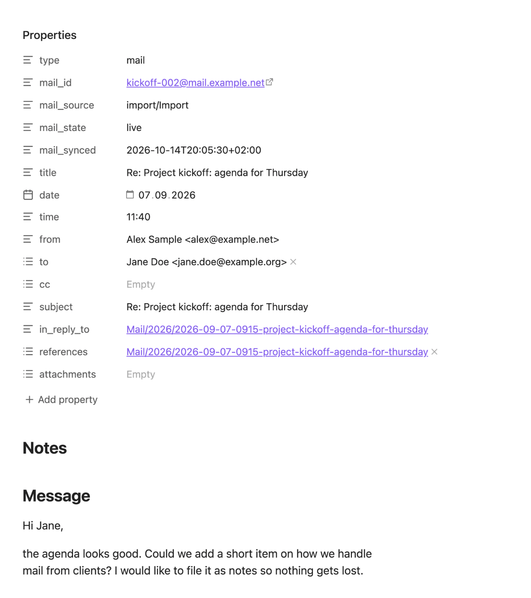
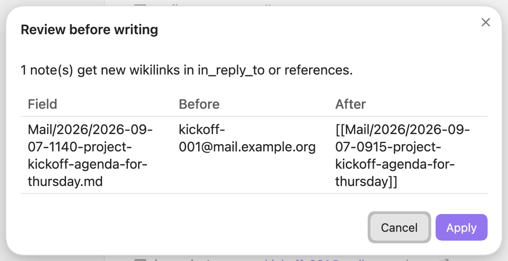
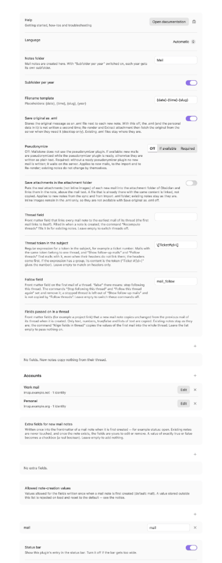

# Mailstone

> [🇬🇧 English](https://github.com/johannes-kaindl/mailstone/blob/main/README.md) · 🇩🇪 Deutsch

**Mailstone macht aus einem Mail-Ordner auf deinem Server Notizen in deinem Vault — der Server entscheidet, was zur Notiz wird, und Lesen markiert nie eine Nachricht als gelesen.**

[](https://github.com/johannes-kaindl/mailstone/blob/main/LICENSE)
[](https://github.com/johannes-kaindl/mailstone/blob/main/LICENSE-DOCS)
[](https://github.com/johannes-kaindl/mailstone/releases)
-7c3aed)

> **Hinweis:** Diese Übersetzung folgt der englischen [`README.md`](https://github.com/johannes-kaindl/mailstone/blob/main/README.md). Bei Abweichungen gilt die englische Fassung.

Die Sichtung bleibt dort, wo die Mail ohnehin liegt: Verschiebe eine Nachricht in einen bestimmten IMAP-Ordner — vom Handy, aus dem Webmailer, per Mail-Regel —, und der nächste Sync schreibt sie als Markdown-Notiz in den Vault, mit der ursprünglichen `.eml` daneben. Der Versand läuft über dasselbe Konto per SMTP, und das Plugin verschickt iMIP-Kalendereinladungen im Auftrag des Schwester-Plugins [`calendar-notes`](https://github.com/johannes-kaindl/calendar-notes).

<p align="center"></p>

## Funktionen

- **Mail als Notiz.** Ein Ordner auf dem Server entscheidet, was zur Notiz wird. Die Message-ID ist die Identität, und die ursprüngliche `.eml` bleibt neben der Notiz liegen — alles Abgeleitete lässt sich daraus neu aufbauen.
- **Ein Panel in der rechten Seitenleiste.** Pro Konto: was der letzte Lauf getan hat, wann der nächste fällig ist, die Zähler, die nicht null sind, der Fehler in Klartext — und ein Knopf zum sofortigen Synchronisieren, für ein Konto oder alle. Der letzte Lauf überlebt einen Neustart.
- **Ein Posteingangs-Tab.** Die letzten 100 Nachrichten deines Posteingangs, mit einem Häkchen für alles, was schon als Notiz vorliegt. Drei Aktionen je Zeile: *Ins Vault übernehmen* und *Archivieren* (beides serverseitig, beides erst nach einer Rückfrage) und — sobald [TaskNotes](https://github.com/callumalpass/tasknotes) installiert ist — *Aufgabe erstellen*.
- **Kommandos auf einer Mail-Notiz.** Neu aufbauen aus der `.eml`, Threads neu verknüpfen, einen Anhang herausholen, im externen Mailprogramm antworten, eine TaskNotes-Aufgabe anlegen. Jedes zeigt eine Vorschau, bevor es schreibt.
- **Import ohne Server.** *.eml-Dateien aus einem Vault-Ordner importieren* macht aus `.eml`-Dateien, die du schon hast, Notizen — ganz ohne Konto.
- **Versand.** SMTP über dasselbe Konto, einschließlich iMIP-Einladungen für `calendar-notes`. Auch andere Plugins können über Mailstone senden, nachdem du jedes einmal bestätigt hast.
- **Lesen markiert nie etwas als gelesen.** Auflisten, Vorschau und Sync nutzen `EXAMINE` und `BODY.PEEK`; beim Verschieben reisen die Flags mit. Ein anderes Werkzeug, das auf „ungelesen“ reagiert, wird nicht gestört.
- **Mobil: lesen, was schon synchronisiert ist.** Synchronisierte Notizen sind auf Mobilgeräten gewöhnliche Markdown-Notizen. Sync, Versand und Posteingangs-Tab brauchen eine Netzwerkschicht, die mobiles Obsidian nicht bietet, und bleiben dort aus.

## Voraussetzungen

- **Obsidian 1.13.0 oder neuer.** Alles am Desktop; mobil nur das Lesen von Notizen, die ein Desktop schon synchronisiert hat.
- **Ein IMAP/SMTP-Konto**, das du mit einem App-Passwort erreichst. Anbieter, die OAuth verlangen (Gmail mit 2FA, Microsoft 365), werden nicht unterstützt — es gibt keinen OAuth-Ablauf.
- **Ein Ordner auf dem Mailserver**, der als Allowlist dient (Standardname `Vault`), und ein zweiter für das Archiv. Was du in den Allowlist-Ordner legst, wird zur Notiz; sonst wird nichts angefasst.
- **TLS ist nicht optional.** Die Zertifikatsprüfung lässt sich nicht abschalten, und Klartext-Anmeldung ohne TLS wird verweigert.

## Installation

### Community Plugins

Einstellungen → Community-Plugins → Durchsuchen → „Mailstone“ → Installieren, dann aktivieren. Updates kommen wie bei jedem Community-Plugin. Die zwei folgenden Wege sind Alternativen.

### AnySource Sideloader

Der [AnySource Sideloader](https://github.com/johannes-kaindl/anysource-sideloader) installiert und aktualisiert Plugins von jeder Git-Forge. Diesen Katalog einmal abonnieren:

```
https://git.jkaindl.de/jkaindl/obsidian-catalog/raw/branch/main/catalog.json
```

Mailstone erscheint dann in der Plugin-Liste des Sideloaders und wird wie jedes andere Plugin aktualisiert, jeder Download mit Prüfsumme verifiziert.

### Manuell

`main.js`, `manifest.json` und `styles.css` aus dem [letzten Release](https://github.com/johannes-kaindl/mailstone/releases/latest) nach `<vault>/.obsidian/plugins/mailstone/` legen, dann das Plugin unter Einstellungen → Community-Plugins aktivieren. Updates müssen dann von Hand wiederholt werden.

### BRAT (Beta)

`johannes-kaindl/mailstone` in [BRAT](https://github.com/TfTHacker/obsidian42-brat) eintragen.

### Aus dem Quelltext

```bash
git clone https://git.jkaindl.de/jkaindl/mailstone
cd mailstone && npm install && npm run build
# main.js manifest.json styles.css → <vault>/.obsidian/plugins/mailstone/
```

`npm run gate` fährt die komplette Prüfstrecke (Lint, Typprüfungen, Unit- und Integrationstests, Reinheitsprüfung, Build). `npm run smoke:e2e -- --port <n>` ist eine reine Maintainer-Prüfung gegen ein laufendes Obsidian mit installiertem TaskNotes und bewusst nicht Teil von `gate`.

## Verwendung

1. **Konto einrichten.** Einstellungen → Mailstone → *Konto hinzufügen*: IMAP- und SMTP-Host, Port und TLS-Modus, Benutzername, ein App-spezifisches Passwort, mindestens eine Identität und die Ordnernamen, wie dein IMAP-Server sie anzeigt. *SMTP-Verbindung testen* prüft Host, TLS und Anmeldung, ohne etwas zu senden.



2. **Auf dem Server entscheiden, welche Mail wichtig ist.** In den Allowlist-Ordner verschieben. Der nächste Sync — alle paar Minuten oder *Jetzt synchronisieren* in der Seitenleiste — schreibt eine Notiz nach `Mail/<Jahr>/` und die `.eml` nach `Mail/<Jahr>/_eml/`.



3. **Oder im Posteingangs-Tab arbeiten.** Seitenleiste über das Ribbon-Symbol oder den Befehl *Mailstone: Seitenleiste öffnen* öffnen, zu **Posteingang** wechseln und bei allem Aufhebenswerten *Ins Vault übernehmen* nutzen. Die Nachricht wandert auf dem Server in den Allowlist-Ordner, und der folgende Sync schreibt die Notiz.
4. **Auf einer Mail-Notiz** bietet die Befehlspalette *Mail-Notiz aus dem Original neu aufbauen*, *Mail-Threads neu verknüpfen*, *Vorgänge neu berechnen*, *Felder im Vorgang angleichen*, *Diesem Vorgang nicht mehr folgen*, *Diesem Vorgang wieder folgen*, *Anhang aus einer Mail-Notiz herausholen*, *Auf eine Mail im externen Mailprogramm antworten* und *TaskNotes-Aufgabe anlegen*. Es erscheinen nur die, die zur geöffneten Notiz passen. Jedes zeigt vor dem Schreiben, was es ändern würde:



### Konfiguration

<a href="https://raw.githubusercontent.com/johannes-kaindl/mailstone/main/docs/images/settings.png"></a><br><sub>Auf die Vorschau klicken für das Bild in voller Größe</sub>

Einstellungen → Mailstone. Pro Konto (*Konto hinzufügen* / *Bearbeiten*):

| Einstellung | Wirkung | Standard |
|---|---|---|
| IMAP / SMTP: Host, Port, TLS | `Implizit` (meist 993/465) oder `STARTTLS` (143/587) | — |
| Benutzername, Passwort | Das Passwort liegt in Obsidians Secret-Storage, nie in `data.json` oder im Vault | — |
| Identitäten | Adressen, von denen du senden darfst; eine ist der Standard | — |
| Ordner: Posteingang | Der Ordner, den der Posteingangs-Tab auflistet | `INBOX` |
| Ordner: Allowlist | Der Ordner, der entscheidet, was zur Notiz wird | `Vault` |
| Ordner: Archiv | Wohin *Archivieren* eine Nachricht verschiebt | `Archive` |
| Ordner: Gesendet | Wo eine Kopie des Gesendeten abgelegt wird; leer schaltet die Kopie ab | `Sent` |
| Synchronisation aktiv / Sync-Intervall (Minuten) | Automatischer Sync pro Konto | an / 5 |
| Vorgängen folgen (kopiert Mails auf dem Server) | **Schreibt auf deinem Mailserver.** Jeder Sync-Lauf kopiert Mails der letzten 60 Tage, die zu einem Vorgang gehören, den du schon im Vault hast (`In-Reply-To`, `References` oder die Kennung im Betreff, Posteingang und Gesendet), in den Allowlist-Ordner, höchstens 50 je Lauf, sodass sie im selben Lauf zu Notizen werden. Das Original bleibt, wo es ist, nichts wird als gelesen markiert oder gelöscht. Nur Desktop; ein beendeter Vorgang wird ausgelassen. Kopiert nichts, solange das *Folgen-Feld* leer ist oder nicht taugt (ein Hinweis unter dem Schalter sagt es). Siehe *So funktioniert es* | **aus** |

Globale Einstellungen:

| Einstellung | Wirkung | Standard |
|---|---|---|
| Notiz-Ordner | Wo Mail-Notizen entstehen, je Jahr ein Unterordner | `Mail` |
| Unterordner je Jahr | Schaltet die Jahres-Unterordner ab | an |
| Original als .eml speichern | Legt das Original neben jede neue Notiz. Aus: keine zweite Kopie der personenbezogenen Daten im Vault; *Neu aufbauen* und *Anhang extrahieren* holen das Original dann per Message-ID vom Server (nur Desktop, nur lesend), und *Gespeicherte .eml-Dateien entfernen* legt die vorhandenen in den Papierkorb. Mails ohne Message-ID behalten ihre `.eml` | an |
| Pseudonymisieren | Aus, Wenn verfügbar oder Verlangt: neue Mails (und der Import sowie *Neu aufbauen*) gehen durch das Plugin `pseudonymizer`, bevor eine Notiz geschrieben wird. Bei allem außer Aus **wird keine `.eml` gespeichert** (ein Original ist Klartext), egal was *Original als .eml speichern* sagt. Siehe *Pseudonymisierung (optional)* | Aus |
| Anhänge im Anhangordner speichern | Legt die echten Anhänge (keine Inline-Bilder) jeder neuen Mail in den Anhangordner von Obsidian und verlinkt sie in der Notiz, oberhalb des Mailtextes, für neue Notizen aus dem Sync und aus *.eml-Ordner importieren*. Liegt dort schon eine Datei mit demselben Inhalt, wird sie verlinkt statt kopiert. Inline-Bilder bleiben der `.eml` vorbehalten. Bei eingeschaltetem *Pseudonymisieren* werden keine Anhänge gespeichert (ein Anhang ist Klartext) | aus |
| Vorgangsfeld | Frontmatter-Feld, das jede Mail-Notiz mit der frühesten Mail ihres Vorgangs verknüpft, die erste Mail mit sich selbst. Wird beim Anlegen gefüllt; *Vorgänge neu berechnen* trägt es in bestehenden Notizen nach. Leer schaltet Vorgänge aus | leer |
| Vorgangs-Kennung im Betreff | Regulärer Ausdruck für eine Kennung im Betreff, etwa eine Ticketnummer. Mails mit derselben Kennung gehören zu einem Vorgang, und *Folge-Mails anzeigen* und *Vorgängen folgen* finden Mails mit ihr, auch wenn ihre Header sie nicht verbinden; die Header gehen vor. Hat der Ausdruck eine Gruppe, ist deren Inhalt die Kennung (`Ticket #(\d+)` ergibt die Nummer). Ein ungültiger Ausdruck oder einer, der bei manchen Betreffs sehr lange laufen könnte, wird ignoriert, und ein Hinweis unter der Zeile sagt es. Leer: nur Header | `\[Ticket#\d+\]` |
| Folgen-Feld | Frontmatter-Feld an der ersten Mail eines Vorgangs. `false` heißt dort: diesem Vorgang nicht mehr folgen. *Diesem Vorgang nicht mehr folgen* und *Diesem Vorgang wieder folgen* setzen und entfernen es. Ein beendeter Vorgang fehlt in *Folge-Mails anzeigen* und wird von *Vorgängen folgen* nicht kopiert. Leer schaltet diese beiden Befehle aus | `mail_follow` |
| Im Vorgang weitergegebene Felder | Liste von Frontmatter-Feldern (etwa `projekt`), die eine neue Notiz beim Anlegen unverändert von der vorigen Mail ihres Vorgangs übernimmt. *Felder im Vorgang angleichen* überträgt die Werte der ersten Mail auf den ganzen Vorgang. Leer gibt nichts weiter | leer |
| Dateinamen-Vorlage | Platzhalter `{date}`, `{time}`, `{slug}`, `{year}` | `{date}-{time}-{slug}` |
| Zusatzfelder für neue Mail-Notizen | Felder, die beim ersten Anlegen einmalig ins Frontmatter geschrieben werden, etwa `status: open` | keine |
| Erlaubte Werte bei Neuanlage | Werte, die für die beim Anlegen geschriebenen Felder zulässig sind | `mail` |
| Plugins mit Sendeerlaubnis | Plugins, die ohne Rückfrage über Mailstone senden; Widerruf fragt wieder | keine |
| Statusleiste | Zeigt den Sync-Stand in der Statusleiste (Desktop); ausschalten, wenn die Leiste zu breit wird | an |
| Beim Start öffnen | Öffnet das Seitenleisten-Panel beim Start von Obsidian | aus |
| Debug-Protokoll | Schreibt den IMAP-/SMTP-Dialog in die Entwicklerkonsole, Passwörter maskiert | aus |
| Sprache | Oberflächensprache | Automatisch |

## Pseudonymisierung (optional)

Mailstone kann jede neue Mail vor dem Schreiben der Notiz an ein eigenes Plugin, `pseudonymizer`, übergeben, damit Namen, Adressen und ähnliche Angaben in Betreff, Absender, Empfängern, Anhangsnamen und Text zu Platzhaltern werden. Die Einstellung *Pseudonymisieren* hat drei Stellungen: *Aus* (Vorgabe; Mailstone nutzt das Plugin nicht), *Wenn verfügbar* (pseudonymisieren, solange das Plugin bereit ist, sonst Klartext schreiben) und *Verlangt* (ohne bereites Plugin wird keine neue Mail geschrieben; sie wartet auf dem Server, und der nächste Sync-Lauf holt sie wieder). Solange die Einstellung nicht *Aus* ist, wird keine `.eml` gespeichert, denn ein Original ist Klartext. Das Plugin `pseudonymizer` ist noch nicht veröffentlicht, *Verlangt* schreibt daher keine neue Mail, bis es existiert und bereit ist; bis dahin bleibt die Einstellung auf *Aus*.

**Wartende Mails.** Eine Mail, die noch nicht geschrieben werden kann (das Plugin fehlt, ist gesperrt oder nicht eingerichtet bei *Verlangt*, oder es will die Mail erst von dir prüfen lassen), bleibt auf dem Server. Die Kontozeile im Seitenpanel zeigt dafür „N warten“, ebenso die Meldung eines manuellen Syncs. Der Befehl *Wartende Mails prüfen* (nur sichtbar, solange die Einstellung nicht *Aus* ist) fährt einen Sync über alle Konten, und der Pseudonymizer darf für diese Mails sein Prüffenster öffnen; der Hintergrund-Sync und der normale Sync-Befehl tun das nie.

**Senden und Antworten.** Platzhalter werden in den Klartext zurückgewandelt, bevor etwas Mailstone verlässt: in Empfängern, Betreff und Text einer Nachricht über die Plugin-API, den calendar-notes-Transport oder die Testmail und im Absender und Betreff von *Auf eine Mail im externen Mailprogramm antworten*. Bei der Plugin-API geschieht das vor dem Bestätigungsfenster, damit es zeigt, was wirklich hinausgeht. Lässt sich ein Platzhalter nicht auflösen, wird nichts gesendet und kein Fenster geöffnet; ein Platzhalter eines vergessenen Eintrags in einem Empfängerfeld ist ein Fehler, in Betreff oder Text geht er als Platzhalter hinaus (das Fenster sagt es).

**Grenzen.** Zwei Stellen tragen bewusst Klartext: der Inhalt herausgezogener Anhänge (mit ihren Originalnamen) und die Kopie einer gesendeten Nachricht, die Mailstone im Ordner *Gesendet* auf dem Server ablegt, weil das ist, was hinausging, und ein Postfach kein Vault ist. Kennungen bleiben unverändert, weil Mailstone eine Mail an ihnen erkennt: `mail_id`, `in_reply_to` und `references` (Message-IDs, die oft eine Domain oder Adresse enthalten; `in_reply_to` bleibt eine rohe ID, solange die Mail, auf die es zeigt, keine Notiz hat), `mail_source` und das Datum. *Folge-Mails anzeigen* listet Betreff und Absender so, wie sie auf dem Server stehen. Der ICS-Teil einer Termineinladung über den calendar-notes-Transport und die Textanhänge einer Nachricht werden nicht zurückgewandelt: trägt einer von ihnen (oder der Name eines Anhangs) noch einen Platzhalter, sendet Mailstone nichts und meldet, wie viele Platzhalter es fand.

## Dokumentation

- [Dokumentations-Index](https://github.com/johannes-kaindl/mailstone/blob/main/docs/README.md) (englisch)
- [Erste Schritte](https://github.com/johannes-kaindl/mailstone/blob/main/docs/getting-started.md) (englisch) — von der Installation bis zur ersten Mail-Notiz
- [Fehlerbehebung](https://github.com/johannes-kaindl/mailstone/blob/main/docs/how-to/troubleshooting.md) (englisch) — die Fehlermeldungen, ihre Ursachen und was zu tun ist

## Funktionsweise

**Der Server entscheidet, nicht das Plugin.** Ein Ordner auf dem Mailserver ist die Allowlist. Der Sync liest ihn, und jede Nachricht darin wird zur Notiz — keine Regel-Engine, keine Filter im Plugin.

**Die Message-ID ist die Identität.** Sie überlebt erneutes Herunterladen, Ordnerwechsel und umbenannte Dateien. Die `.eml` neben jeder Notiz ist die Treuefläche: Frontmatter, gerenderter Text und Anhänge lassen sich daraus neu aufbauen, eine Formatänderung kostet also nie Daten.

**Die `.eml` ist optional.** Wer keine zweite Kopie der Nachricht (samt den personenbezogenen Daten darin) im Vault will, schaltet *Original als .eml speichern* aus. Notizen entstehen wie bisher; braucht *Neu aufbauen* oder *Anhang extrahieren* dann das Original, holt Mailstone es per Message-ID vom Server, nur lesend und ohne etwas als gelesen zu markieren, und sucht im Ordner der Notiz, dann im Allowlist- und im Archivordner. Das geht nur am Desktop und nur, solange die Nachricht noch auf dem Server liegt; sonst nennt der Befehl die durchsuchten Ordner. *Gespeicherte .eml-Dateien entfernen* legt die vorhandenen in den Papierkorb (nach einer Vorschau, nie eine Notiz).

**Vorgänge sind Links, keine Ordner.** Ist ein *Vorgangsfeld* gesetzt (etwa `vorgang`), bekommt jede neue Notiz einen Link auf die früheste Mail ihres Vorgangs, gefunden über `In-Reply-To`, `References` und, wenn beides nichts findet, eine Kennung im Betreff (Einstellung *Vorgangs-Kennung im Betreff*, Vorgabe `\[Ticket#\d+\]`; Mails mit derselben Kennung gehören zu einem Vorgang, auch wenn ihre Header sie nicht verbinden, und die Header gehen immer vor). Eine neue Notiz übernimmt den Wert der Mail, auf die sie antwortet; beim Sync wird also nichts neu gruppiert. *Vorgänge neu berechnen* gruppiert den ganzen Vault neu, wenn du es willst (nach einer Vorschau, und es ändert nur dieses eine Feld). Weil der Wert ein gewöhnlicher Link ist, kann eine Base danach gruppieren.

**Felder können mit dem Vorgang wandern.** Trage unter *Im Vorgang weitergegebene Felder* Frontmatter-Felder ein (etwa `projekt`), und eine neue Notiz übernimmt sie von der vorigen Mail ihres Vorgangs: der Mail, auf die sie antwortet, sonst der zuletzt in `References` genannten, die in deinem Vault liegt, sonst der jüngsten früheren Mail mit derselben Kennung im Betreff. Die vorige Mail darf im selben Lauf eintreffen; dann gilt deren Wert. Die Werte werden unverändert kopiert, eine Liste von Links bleibt also eine Liste von Links und `true` bleibt `true`; weitergegeben werden nur Text, Zahlen, wahr/falsch und Listen von Text, und ein Feld, das Mailstone selbst verwaltet (etwa `subject`), das *Vorgangsfeld* und das *Folgen-Feld* werden mit einem Hinweis unter der Liste abgelehnt. Das passiert nur beim Anlegen; *Felder im Vorgang angleichen* schreibt die Werte der ersten Mail danach in alle Notizen des Vorgangs (nach einer Vorschau, nur Frontmatter, ein fehlendes Feld wird angelegt, ein Feld, das die erste Mail nicht hat, wird nie gelöscht).

**Folge-Mails.** *Folge-Mails anzeigen* (Desktop, Befehlspalette) liest den Posteingang und den Ordner „Gesendet“ jedes Kontos, nur lesend (`EXAMINE`, `BODY.PEEK`, kein `\Seen`), und listet, nach Vorgang gruppiert, die Mails der letzten 60 Tage, die über `In-Reply-To`, `References` oder die Kennung im Betreff zu einem Vorgang in deinem Vault gehören, aber noch keine Notiz haben. Es zeigt nur, was da ist, und schreibt nichts. *Diesem Vorgang nicht mehr folgen* und *Diesem Vorgang wieder folgen* markieren die erste Mail eines Vorgangs mit `false` im *Folgen-Feld* (nach einer Vorschau, nur Frontmatter); ein beendeter Vorgang fehlt in dieser Liste und beim Kopieren unten.

**Vorgängen folgen schreibt auf deinem Mailserver (Opt-in, standardmäßig aus).** Ist *Vorgängen folgen* für ein Konto eingeschaltet, findet jeder Sync-Lauf zuerst diese Folge-Mails und **kopiert** sie dann (`UID COPY`) aus dem Posteingang oder aus „Gesendet“ in den Allowlist-Ordner auf dem Server, höchstens 50 je Lauf, die ältesten zuerst. Der normale Sync danach macht aus den Kopien im selben Lauf Notizen. Warum eine Kopie: Der Allowlist-Ordner bleibt die eine Wahrheit darüber, was zur Notiz wird, und die Mail bleibt dort sichtbar, wo sie war. Was du vor dem Einschalten wissen solltest: Der Allowlist-Ordner wächst um diese Kopien (die Mails liegen doppelt auf dem Server und zählen für dein Kontingent); eine Kopie behält die Flags des Originals, eine ungelesene Mail ist im Allowlist-Ordner also auch ungelesen, und alles andere, was diesen Ordner beobachtet (ein anderes Werkzeug, eine Mailregel), sieht die Kopien als neue Post; verschiebst du eine Kopie aus dem Ordner, wird ihre Notiz wie gewohnt abgelöst. Eine Mail wird nie zweimal kopiert (Mailstone sucht vorher im Allowlist-Ordner nach ihrer Message-ID), und eine Mail ohne brauchbare Message-ID wird gar nicht kopiert. Mailstone liest wie bisher mit `EXAMINE` und `BODY.PEEK` und öffnet die schreibende Verbindung nur, wenn es etwas zu kopieren gibt; es markiert nie etwas als gelesen, verschiebt oder löscht nichts. Gescheiterte Kopien (Kontingent, Rechte, ein Ordner, den es nicht gibt) zählen im Lauf als Fehler und halten ihn nicht an. Auch bei leerem oder unbrauchbarem *Folgen-Feld* wird nichts kopiert: ohne es könnte Mailstone nicht erkennen, welche Vorgänge du beendet hast, deshalb entfällt der Schritt, und der Sync selbst läuft wie gewohnt. Schaltest du es aus, wird nichts mehr kopiert; schon gemachte Kopien bleiben.

**Notizen werden zusammengeführt, nicht überschrieben.** Dein eigener Text steht außerhalb einer markierten Zone (`%% mailstone:begin %%` … `%% mailstone:end %%`) und wird vor jedem Schreiben per Hash verglichen. Hast du den verwalteten Abschnitt von Hand bearbeitet, wird das Schreiben verweigert, statt es still anzuwenden. Mailstone löscht nie eine Notiz: Eine Nachricht, die den Ordner verlässt, wird als `detached` markiert, und beim Zurücklegen wird sie wieder verbunden.

**Zwei Arten von IMAP-Sitzung, vom Compiler erzwungen.** Der Lesepfad kann weder `SELECT` noch `UID MOVE` noch `UID COPY` aufrufen; das liegt auf einer getrennten Sitzung, die nur die Posteingangs-Aktionen und der optionale Schritt *Vorgängen folgen* nutzen. Deshalb ist „Lesen markiert nie als gelesen“ eine Eigenschaft des Typsystems und keine Regel, an die jemand denken muss. Architektur und Konventionen stehen in [`AGENTS.md`](https://github.com/johannes-kaindl/mailstone/blob/main/AGENTS.md).

## Mitwirken

Issues und Pull Requests auf [GitHub](https://github.com/johannes-kaindl/mailstone/issues); das kanonische Repository liegt auf [git.jkaindl.de](https://git.jkaindl.de/jkaindl/mailstone). Testgetrieben (`npm test`, volle Prüfung mit `npm run gate`); größere Features laufen über Brainstorm → Spec → Plan → TDD. Siehe [`AGENTS.md`](https://github.com/johannes-kaindl/mailstone/blob/main/AGENTS.md).

## Lizenz

- **Code:** AGPL-3.0-or-later ([`LICENSE`](https://github.com/johannes-kaindl/mailstone/blob/main/LICENSE); Dual-License-Option in [`LICENSING.md`](https://github.com/johannes-kaindl/mailstone/blob/main/LICENSING.md)).
- **Doku/Text:** CC BY-SA 4.0 ([`LICENSE-DOCS`](https://github.com/johannes-kaindl/mailstone/blob/main/LICENSE-DOCS)).

Copyright © 2026 Johannes Kaindl.
