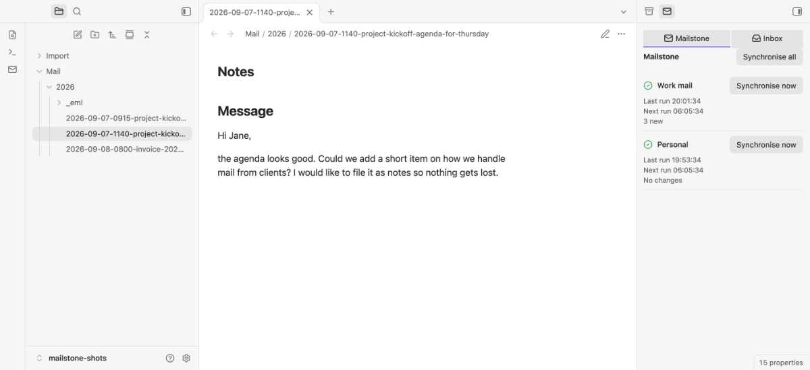
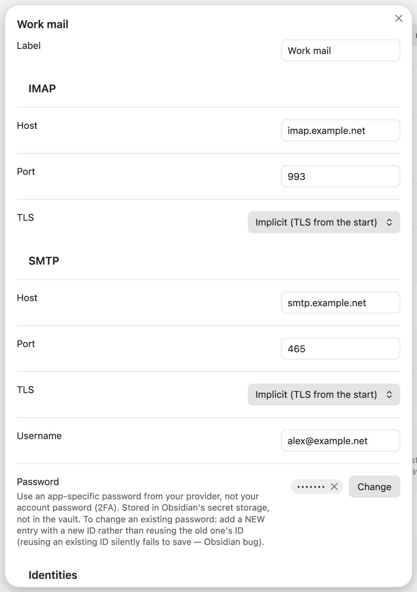
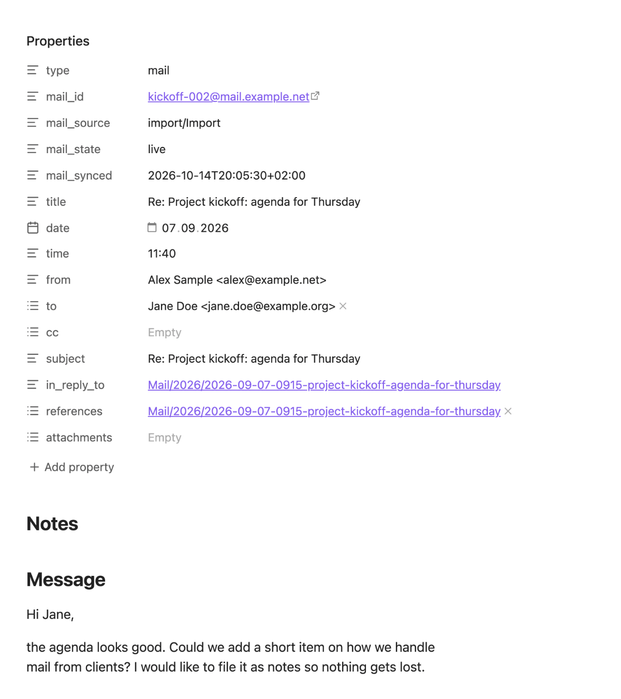
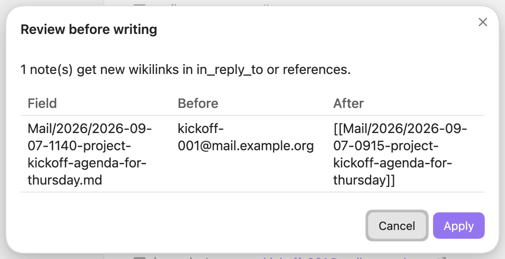
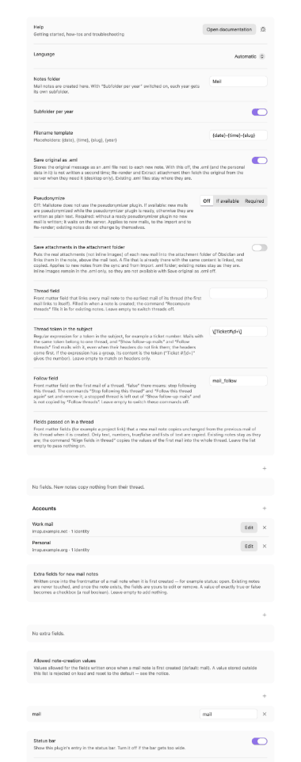

# Mailstone

> 🇬🇧 English · [🇩🇪 Deutsch](https://github.com/johannes-kaindl/mailstone/blob/main/README.de.md)

**Mailstone turns a mail folder on your server into notes in your vault — the server decides what becomes a note, and reading never marks a message as read.**

[](https://github.com/johannes-kaindl/mailstone/blob/main/LICENSE)
[](https://github.com/johannes-kaindl/mailstone/blob/main/LICENSE-DOCS)
[](https://github.com/johannes-kaindl/mailstone/releases)
-7c3aed)

Triage stays where your mail already lives: move a message into one designated IMAP folder — from your phone, from webmail, from a mail rule — and the next sync writes it into the vault as a Markdown note, with the original `.eml` beside it. Sending uses the same account over SMTP, and the plugin delivers iMIP calendar invitations on behalf of the sister plugin [`calendar-notes`](https://github.com/johannes-kaindl/calendar-notes).

<p align="center"></p>

## Features

- **Mail as notes.** A server-side folder decides what becomes a note. The Message-ID is the identity, and the original `.eml` stays next to the note, so everything derived from it can be rebuilt.
- **A panel in the right sidebar.** Per account: what the last run did, when the next one is due, the counters that are not zero, the error in plain words — and a button to synchronise now, for one account or all of them. The last run survives a restart.
- **An inbox tab.** The last 100 messages of your inbox, with a tick for everything that is already a note. Three actions per row: *Move to vault* and *Archive* (both server-side, both after a confirmation) and — once [TaskNotes](https://github.com/callumalpass/tasknotes) is installed — *Create task*.
- **Commands on a mail note.** Re-render from the original (the `.eml`, or the message fetched from the server), relink threads, extract an attachment, reply in your external mail client, create a TaskNotes task. Each shows a preview before it writes.
- **Import without a server.** *Import .eml files from a vault folder* turns `.eml` files you already have into notes — no account needed.
- **Sending.** SMTP through the same account, including iMIP invitations for `calendar-notes`. Other plugins can send through Mailstone too, after you confirm each one once.
- **Reading never marks anything as read.** Listing, previewing and syncing use `EXAMINE` and `BODY.PEEK`; moving a message carries its flags along. Another tool that keys off "unread" is not disturbed.
- **Mobile: read what is already synced.** Synchronised notes are ordinary Markdown notes on mobile. Sync, sending and the inbox tab need a network layer mobile Obsidian does not provide and stay off there.

## Requirements

- **Obsidian 1.13.0 or newer.** Desktop for everything; mobile only reads notes that a desktop already synchronised.
- **An IMAP/SMTP account** you can reach with an app password. Providers that require OAuth (Gmail with 2FA, Microsoft 365) are not supported — there is no OAuth flow.
- **A folder on the mail server** that acts as the allowlist (default name `Vault`), and a second one for the archive. Anything you file in the allowlist folder becomes a note; nothing else is touched.
- **TLS is not optional.** Certificate checking cannot be turned off, and plaintext authentication without TLS is refused.

## Install

### Community Plugins

Settings → Community plugins → Browse → "Mailstone" → Install, then enable it. Updates arrive like for any Community plugin. The two ways below are alternatives.

### AnySource Sideloader

[AnySource Sideloader](https://github.com/johannes-kaindl/anysource-sideloader) installs and updates plugins from any git forge. Subscribe to this catalog once:

```
https://git.jkaindl.de/jkaindl/obsidian-catalog/raw/branch/main/catalog.json
```

Mailstone then appears in the sideloader's plugin list and updates like any other plugin, every download checksum-verified.

### Manual

Download `main.js`, `manifest.json` and `styles.css` from the [latest release](https://github.com/johannes-kaindl/mailstone/releases/latest) into `<vault>/.obsidian/plugins/mailstone/`, then enable the plugin in Settings → Community plugins. Updates then have to be repeated by hand.

### BRAT (beta)

Add `johannes-kaindl/mailstone` in [BRAT](https://github.com/TfTHacker/obsidian42-brat).

### From source

```bash
git clone https://git.jkaindl.de/jkaindl/mailstone
cd mailstone && npm install && npm run build
# main.js manifest.json styles.css → <vault>/.obsidian/plugins/mailstone/
```

`npm run gate` runs the full check suite (lint, type checks, unit and integration tests, purity check, build). `npm run smoke:e2e -- --port <n>` is a maintainer-only check against a running Obsidian with TaskNotes installed; it is deliberately not part of `gate`.

## Usage

1. **Set up an account.** Settings → Mailstone → *Add account*: IMAP and SMTP host, port and TLS mode, username, an app-specific password, at least one identity, and the folder names as your IMAP server shows them. *Test SMTP connection* checks host, TLS and login without sending anything.



2. **Decide on the server which mail matters.** Move it into your allowlist folder. The next sync — every few minutes, or *Synchronise now* in the sidebar — writes a note under `Mail/<year>/` and the `.eml` under `Mail/<year>/_eml/`.



3. **Or work from the inbox tab.** Open the sidebar with the ribbon icon or the command *Mailstone: Open the sidebar panel*, switch to **Inbox**, and use *Move to vault* on anything worth keeping. The message moves into the allowlist folder on the server, and the following sync writes the note.
4. **On a mail note**, the command palette offers *Re-render mail note from its original*, *Relink mail threads*, *Recompute threads*, *Align fields in thread*, *Stop following this thread*, *Follow this thread again*, *Extract an attachment from a mail note*, *Reply to a mail in the external mail client* and *Create a TaskNotes task*. Only the ones that apply to the open note appear. Each one shows what it would change before it writes:



### Configuration

<a href="https://raw.githubusercontent.com/johannes-kaindl/mailstone/main/docs/images/settings.png"></a><br><sub>Click the preview for the full-size image</sub>

Settings → Mailstone. Per account (*Add account* / *Edit*):

| Setting | What it does | Default |
|---|---|---|
| IMAP / SMTP: Host, Port, TLS | `Implicit` (usually 993/465) or `STARTTLS` (143/587) | — |
| Username, Password | The password lives in Obsidian's secret storage, never in `data.json` or the vault | — |
| Identities | Addresses you may send from; one is the default | — |
| Folders: Inbox | The folder the inbox tab lists | `INBOX` |
| Folders: Allowlist | The folder that decides what becomes a note | `Vault` |
| Folders: Archive | Where *Archive* moves a message | `Archive` |
| Folders: Sent | Where a sent copy is filed; empty turns the copy off | `Sent` |
| Sync enabled / Sync interval (minutes) | Automatic sync per account | on / 5 |
| Follow threads (copies mails on the server) | **Writes on your mail server.** Each sync run copies mails of the last 60 days that belong to a thread you already have in your vault (`In-Reply-To`, `References` or the subject token, inbox and sent folder) into the allowlist folder, at most 50 per run, so they become notes in the same run. The original stays where it is, and nothing is marked as read or deleted. Desktop only; a stopped thread is left out. Copies nothing while the *Follow field* is empty or unusable (a note under the switch says so). See *How it works* | **off** |

Global settings:

| Setting | What it does | Default |
|---|---|---|
| Notes folder | Where mail notes are created, in a subfolder per year | `Mail` |
| Subfolder per year | Turns the year subfolders off | on |
| Save original as .eml | Writes the original next to each new note. Off: no second copy of the personal data in the vault; *Re-render* and *Extract an attachment* then fetch the original from the server by Message-ID (desktop only, read-only), and *Remove stored .eml files* trashes the ones you already have. Mails without a Message-ID keep their `.eml` | on |
| Pseudonymize | Off, If available or Required: new mails (and the import and *Re-render*) go through the plugin `pseudonymizer` before a note is written. With anything but Off, **no `.eml` is stored** (an original is plain text), whatever *Save original as .eml* says. See *Pseudonymization (optional)* | Off |
| Thread field | Front matter field that links every mail note to the earliest mail of its thread, the first mail to itself. Filled in when a note is created; *Recompute threads* fills it in for existing notes. Empty switches threads off | empty |
| Thread token in the subject | Regular expression for a token in the subject, such as a ticket number. Mails with the same token belong to one thread, and *Show follow-up mails* and *Follow threads* find mails with it, even when their headers do not link them; headers come first. With a group in the expression its content is the token (`Ticket #(\d+)` gives the number). An invalid expression, or one that could run very long on some subjects, is ignored and a note under the row says so. Empty: headers only | `\[Ticket#\d+\]` |
| Follow field | Front matter field on the first mail of a thread. `false` there means: stop following this thread. *Stop following this thread* and *Follow this thread again* set and remove it. A stopped thread is left out of *Show follow-up mails* and is not copied by *Follow threads*. Empty switches these two commands off | `mail_follow` |
| Fields passed on in a thread | A list of front matter fields (for example `projekt`) that a new note copies unchanged from the previous mail of its thread when it is created. *Align fields in thread* copies the first mail's values into the whole thread. Empty passes nothing on | empty |
| Filename template | Placeholders `{date}`, `{time}`, `{slug}`, `{year}` | `{date}-{time}-{slug}` |
| Extra fields for new mail notes | Fields written once into a note's front matter when it is first created, for example `status: open` | none |
| Allowed note-creation values | Values accepted for the fields written at creation | `mail` |
| Plugins allowed to send | Plugins that send through Mailstone without asking; revoke one to be asked again | none |
| Status bar | Shows the sync state in the status bar (desktop); turn it off if the bar gets too wide | on |
| Open the panel at startup | Opens the sidebar panel when Obsidian starts | off |
| Debug log | Writes the IMAP/SMTP dialogue to the developer console, passwords masked | off |
| Language | Interface language | Automatic |

## Pseudonymization (optional)

Mailstone can hand every new mail to a separate plugin, `pseudonymizer`, before the note is written, so that names, addresses and similar details in the subject, sender, recipients, attachment names and text become placeholders. The setting *Pseudonymize* has three positions: *Off* (the default; Mailstone does not use the plugin), *If available* (pseudonymize while the plugin is ready, otherwise write plain text) and *Required* (without a ready plugin no new mail is written; it waits on the server and the next sync run fetches it again). While the setting is not *Off*, no `.eml` is stored, because an original is plain text. The plugin `pseudonymizer` is not published yet, so *Required* writes no new mail until it exists and is ready; leave the setting *Off* until then.

**Waiting mails.** A mail that cannot be written yet (the plugin is missing, locked or not set up with *Required*, or it wants you to review the mail first) stays on the server. The account line in the sidebar panel shows "N waiting" for it, and so does the notice of a manual sync. The command *Check waiting mails* (listed only while the setting is not *Off*) runs a sync over all accounts, and the pseudonymizer may open its review window for these mails; the background sync and the normal sync command never do.

**Sending and replying.** Placeholders are turned back into the original text before anything leaves Mailstone: in the recipients, the subject and the text of a message sent through the plugin API, the calendar-notes transport or the test mail, and in the sender and subject of *Reply to a mail in the external mail client*. For the plugin API this happens before the confirmation dialog, so the dialog shows what is really sent. If a placeholder cannot be resolved, nothing is sent and no dialog opens; a placeholder of a forgotten entry in a recipient field is an error, and in subject or text it is sent as the placeholder (the dialog says so).

**Limits.** Two places hold plain text on purpose: the content of attachments you extract (with their original names), and the copy of a sent message that Mailstone files in the *Sent* folder on the server, because that is what went out and a mailbox is not a vault. The ICS part of a calendar invitation sent through the calendar-notes transport and the text attachments of a message are not converted back: if one of them (or the name of an attachment) still contains a placeholder, Mailstone sends nothing and reports how many placeholders it found.

## Documentation

- [Documentation index](https://github.com/johannes-kaindl/mailstone/blob/main/docs/README.md)
- [Getting started](https://github.com/johannes-kaindl/mailstone/blob/main/docs/getting-started.md) — from installation to your first mail note
- [Troubleshooting](https://github.com/johannes-kaindl/mailstone/blob/main/docs/how-to/troubleshooting.md) — the error messages, what causes them, what to do

## How it works

**The server decides, not the plugin.** A folder on the mail server is the allowlist. Sync reads it, and every message in it becomes a note — no rules engine, no filters in the plugin.

**The Message-ID is the identity.** It survives re-downloads, folder moves and renamed files. The `.eml` next to each note is the fidelity surface: front matter, rendered body and attachments can be rebuilt from it, so a formatting change never costs you data.

**The `.eml` is optional.** If you would rather not keep a second copy of the message (and the personal data in it) in the vault, switch off *Save original as .eml*. Notes are written as before; when *Re-render* or *Extract an attachment* then needs the original, Mailstone fetches it from the server by Message-ID, read-only and without marking anything as read, searching the note's folder, then the allowlist and archive folders. That works on the desktop only, and it needs the message to still be on the server; if it is not, the command says which folders it searched. *Remove stored .eml files* moves the ones you already have to the trash (after a preview, never touching a note).

**Threads are links, not folders.** With a *Thread field* set (say `vorgang`), every new note gets a link to the earliest mail of its thread, found through `In-Reply-To`, `References` and, failing those, a token in the subject (setting *Thread token in the subject*, default `\[Ticket#\d+\]`; mails with the same token share a thread even when their headers do not link them, and the headers always win). A new note takes the value of the mail it replies to, so nothing is regrouped at sync time; *Recompute threads* regroups the whole vault when you want it (after a preview, and it changes nothing but that one field). Because the value is an ordinary link, a Base can group by it.

**Fields can travel with the thread.** List front matter fields under *Fields passed on in a thread* (say `projekt`), and a new note copies them from the previous mail of its thread: the mail it replies to, or else the last mail named in `References` that is in your vault, or else the latest earlier mail with the same token in the subject. The previous mail may arrive in the same run; then its value counts. Values are copied as they are, so a list of links stays a list of links and `true` stays `true`; only text, numbers, true/false and lists of text are passed on, and a field Mailstone manages itself (such as `subject`), the *Thread field* and the *Follow field* are refused, with a note under the list. It happens only when a note is created; *Align fields in thread* writes the first mail's values into every note of the thread afterwards (after a preview, front matter only, adding a field where it is missing, never deleting one the first mail lacks).

**Follow-up mails.** *Show follow-up mails* (desktop, command palette) reads the inbox and the sent folder of every account, read-only (`EXAMINE`, `BODY.PEEK`, no `\Seen`), and lists, grouped by thread, the mails of the last 60 days that belong to a thread in your vault through `In-Reply-To`, `References` or the subject token but have no note yet. It shows what is there and writes nothing. *Stop following this thread* and *Follow this thread again* mark the first mail of a thread with `false` in the *Follow field* (after a preview, front matter only); a stopped thread is left out of that list and of the copying below.

**Following threads writes on your mail server (opt-in, off by default).** With *Follow threads* switched on for an account, each sync run first finds those follow-up mails, and then **copies** them (`UID COPY`) from the inbox or sent folder into the allowlist folder on the server, at most 50 per run, oldest first. The normal sync that follows turns the copies into notes in the same run. Why a copy: the allowlist folder stays the one source of truth for what becomes a note, and the mail stays visible where it was. What you should know before you switch it on: the allowlist folder grows by those copies (the mails exist twice on the server and count against your quota); a copy keeps the flags of the original, so an unread mail is unread in the allowlist folder too, and anything else that watches that folder (another tool, a mail rule) sees the copies as new mail; moving a copy out of the folder detaches its note as usual. A mail is never copied twice (Mailstone checks the allowlist folder for its Message-ID first), and a mail without a usable Message-ID is not copied at all. Mailstone reads with `EXAMINE` and `BODY.PEEK` as before and opens the writing connection only when there is something to copy; it never marks anything as read, moves or deletes. Failed copies (quota, rights, a folder that does not exist) count as errors in the run and do not stop it. Nothing is copied either while the *Follow field* is empty or unusable: without it Mailstone could not tell which threads you stopped, so the step is skipped and the sync itself runs as usual. Turn the switch off and nothing is copied any more; copies already made stay.

**Notes are merged, not overwritten.** Your own text lives outside a marked zone (`%% mailstone:begin %%` … `%% mailstone:end %%`) and is compared by hash before any write. If you edited the managed zone, the write is refused rather than silently applied. Mailstone never deletes a note: a message that leaves the folder is marked `detached`, and putting it back reattaches it.

**Two kinds of IMAP session, enforced by the compiler.** The read path cannot call `SELECT`, `UID MOVE` or `UID COPY`; those live on a separate session used only by the inbox actions and by the optional *Follow threads* step. That is why "reading never marks as read" is a property of the type system, not a rule someone has to remember. Architecture and conventions are in [`AGENTS.md`](https://github.com/johannes-kaindl/mailstone/blob/main/AGENTS.md).

## Contributing

Issues and pull requests on [GitHub](https://github.com/johannes-kaindl/mailstone/issues); the canonical repository is on [git.jkaindl.de](https://git.jkaindl.de/jkaindl/mailstone). Test-driven (`npm test`, full check with `npm run gate`); larger features go through brainstorm → spec → plan → TDD. See [`AGENTS.md`](https://github.com/johannes-kaindl/mailstone/blob/main/AGENTS.md).

## License

- **Code:** AGPL-3.0-or-later ([`LICENSE`](https://github.com/johannes-kaindl/mailstone/blob/main/LICENSE); dual-license option in [`LICENSING.md`](https://github.com/johannes-kaindl/mailstone/blob/main/LICENSING.md)).
- **Docs/Text:** CC BY-SA 4.0 ([`LICENSE-DOCS`](https://github.com/johannes-kaindl/mailstone/blob/main/LICENSE-DOCS)).

Copyright © 2026 Johannes Kaindl.
